<!-- The images in assets/ are built by tools/build_assets.py. Edit the data there and re-run it. -->

<a href="https://mrabbyilyas.com">
  <picture>
    <source media="(prefers-color-scheme: dark)" srcset="assets/hero-dark.svg">
    
  </picture>
</a>

  &nbsp;
  &nbsp;
  &nbsp;
  

 

<picture>
  <source media="(prefers-color-scheme: dark)" srcset="assets/work-dark.svg">
  
</picture>

  
  
   
  
  

 

<picture>
  <source media="(prefers-color-scheme: dark)" srcset="assets/stack-dark.svg">
  
</picture>

 

<a href="https://mrabbyilyas.com/about">
  <picture>
    <source media="(prefers-color-scheme: dark)" srcset="assets/journey-dark.svg">
    
  </picture>
</a>

  
<b>Earlier builds</b>

   

| Project | What it does | Year |
| --- | --- | --- |
| AI Overview Dashboard | Growthmarketing.tw: bilingual SEO intelligence, 2,000+ keywords, ~4x faster reports | 2025 |
| BD Planning Tool | Comms8: cut proposal prep time by ~40% for London, HK and Tokyo teams | 2025 |
| [Argify](https://argify.vercel.app/) | Turns arguments into Toulmin-model logic graphs | 2025 |
| [Sclook](https://sclook.vercel.app/) | OCR for documents, invoices and business cards | 2025 |
| [LeadIntel](https://lead-gen-saas-nu.vercel.app/) | B2B company intelligence with AI lead scoring | 2025 |

 

<a href="mailto:muhammadrabby7@gmail.com">
  <picture>
    <source media="(prefers-color-scheme: dark)" srcset="assets/contact-dark.svg">
    
  </picture>
</a>

